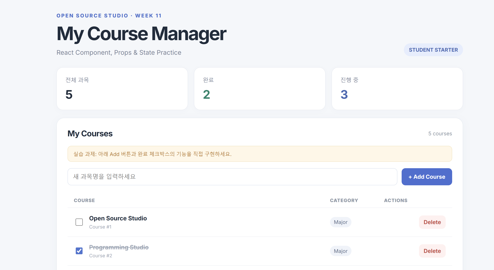

# 1 Project Information
리액트를 이용한 Course Manager. 과목 조회/추가/삭제 기능이 있으며, 과목별 상태 변경이 가능하다.
### [원본 sample URL](https://github.com/2026-2-OSS/week11_sample_project)

# 2 Installation
npm install로 설치, npm run dev로 실행
### 실행 화면

# 3 Source Code Exploration
## 1 Project Structure
- **App.jsx** : 최상위 컨테이너, 제목과 푸터를 감싸며, 메인 컨텐츠인 <CourseList/> 컴포넌트를 화면 중앙에 불러와 배치.
- **CourseList.jsx** : 목록 관리, 과목들의 목록을 useState로 갖는 핵심 파일. 데이터를 가공하는 함수를 정의하고, 배열의 개수만큼 <CourseItem/>을 찍어냄.
- **CourseItem.jsx** : 개별 UI, 과목 하나의 UI를 그리는 틀. 부모에서 정의한 대로 화면에 데이터 보여주고, 버튼이 눌리면 부모에게서 받은 함수를 대신 실행.

## 2 Component & Props

## 3 State & Event

## 4 Code Analysis

# 4 Customizing

# 5 Feature Extension

# 6 Deployment

# 7 Weekly Review
